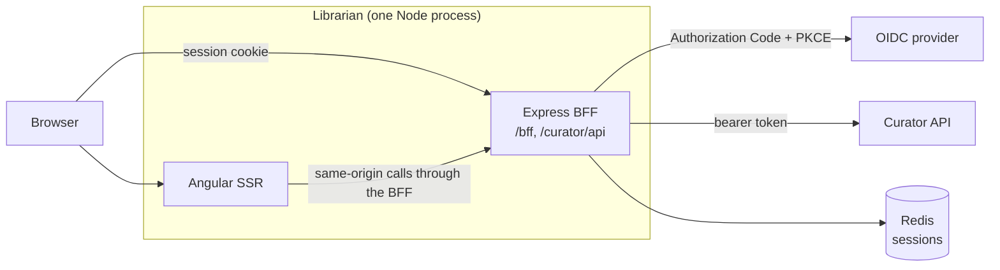

# Architecture

## Bird's-eye view

Librarian is the web front end of a PlayStation game-curation service. One Node process runs an Angular
22 server-side renderer and an Express Backend-for-Frontend (BFF). The BFF holds the user's OIDC session
and proxies every data call to the Curator API with the session's bearer token, so the browser never sees
an access token.

## Codemap

| Part | What it does |
|---|---|
| `src/server.ts` | the Express app and its middleware order (below) |
| `src/bff/` | OIDC sign-in and callback (`openid-client` v6), the session store, the Curator proxy, CSRF, `sitemap.xml` and `robots.txt`, and settings validation (`settings.ts`) |
| `src/app/` | the application shell: routes (`app.routes.ts`), render modes (`app.routes.server.ts`), guards, the HTTP interceptor, navigation |
| `src/auth/`, `src/admin/` | the client-side session, and admin status read from the session's claims |
| `src/curator/` | `CuratorService` and `MeService` over the proxied API, and the shared response types |
| `src/home/`, `src/catalog/`, `src/library/`, `src/collections/`, `src/public-collection/`, `src/consoles/`, `src/psn/`, `src/profile/`, `src/faq/`, `src/privacy/`, `src/not-found/` | one folder per page or page family; `src/psn/` is the `/account` page |
| `src/shared/` | reusable components, typography directives, and the constants the BFF and the browser share (`bff-contract.ts`) |
| `src/telemetry/`, `instrumentation.mjs` | OpenTelemetry (OTLP) and `pino` logging to Elasticsearch, loaded before the app with `--import` |
| `src/environments/` | per-configuration values, notably the SSR `allowedHosts`, swapped through `fileReplacements` |
| `src/testing/`, `e2e/`, `integration/` | unit-test helpers, the Playwright journeys with their mock Curator and mock OIDC servers, and the Integration tier ([TESTING.md](TESTING.md)) |
| `tools/stylelint/` | the stylesheet linter with its own lockfile, so its dependencies stay out of the app's |

## The server

Middleware runs in this order: `trust proxy` → `/health` → span naming → `Server-Timing` → request
logging → session → `/bff` → `/curator/api` → `/sitemap.xml` and `/robots.txt` → static files → the
Angular catch-all. `/health` answers `Healthy` above the logger and is untraced.

- **Session.** The cookie is `librarian.sid`. Sessions live in Redis unless `SessionStore=memory`.
  `sameSite` is `lax`, not `strict`: the OIDC callback is a top-level GET arriving by redirect from the
  provider's origin, and a strict cookie would be withheld there, so the PKCE verifier and state would
  never reach `/bff/callback`. Lax still withholds the cookie from cross-site subrequests.
- **Sign-in.** The BFF requests the scopes `offline_access openid profile email curator`. `/bff/callback`
  copies an allowlisted set of access-token claims (such as `curator.admin`) into the session, so the
  browser learns admin status with no extra request. `GET /bff/user` answers a visitor with no session
  with `200` and a `null` body.
- **Proxy.** `/curator/api/**` is forwarded to `CuratorApiAddress` with the session's bearer token,
  resolving the upstream path from `req.url`, refreshing a token near expiry, and retrying once on a 401
  that carries `WWW-Authenticate`. It strips hop-by-hop headers and the browser's `Cookie`, so the session
  cookie never leaves the BFF. Every mutating call must carry `X-CSRF: 1`.
- **Sitemap.** `/sitemap.xml` pages Curator's anonymous catalog and is cached a day per origin.
- **Telemetry.** `Server-Timing` exposes the trace parent to the browser; there is no browser-side
  OpenTelemetry.

## Rendering

`src/app/app.routes.server.ts` sets each route's render mode. `/`, `/catalog`, `/catalog/:gameId`,
`/faq`, `/privacy` and the not-found catch-all render on the server, for search engines and so the
catch-all can return a real 404. Every route behind `authGuard`, and the anonymous `/c/:slug` share page,
renders on the client: the guard needs the browser's session state, and under server rendering it would
return nothing. Every route must have an entry there.

A server-rendered page hands its Curator responses to the browser through Angular's HTTP transfer cache,
so hydration does not ask again. The interceptor forwards the SSR request's `Cookie` to same-origin
calls, because Node's `fetch` has no cookie jar.

## Pages

| Route | Purpose |
|---|---|
| `/` | home, with a summary of the signed-in user's library |
| `/catalog`, `/catalog/:gameId` | browse the shared game catalog, anonymous |
| `/library`, `/library/:sub`, `/library/ps-plus` | your library or another user's public one; PS Plus catalog titles you have not claimed, are leaving, or have lapsed |
| `/collections`, `/collections/d/:definitionId`, `/collections/:sub` | create, preview, run, edit and share collections; another user's public ones |
| `/c/:slug` | a collection's public share link, anonymous |
| `/consoles` | consoles, storage devices and install state |
| `/account` | PSN link and unlink, harvest preferences, provider keys, the refresh schedule, device links, account deletion |
| `/profile`, `/u/:sub` and their `followers`, `following` and `settings` | public profiles and the follow graph |
| `/admin/enrichment` | catalog-wide enrichment runs, admins only |
| `/faq`, `/privacy` | statements about live behavior, kept true with the code |

**The library is server-driven.** Sorting, filtering, title search and paging are query parameters
against Curator, and TanStack Table runs in manual mode, so the whole library never reaches the browser.
A game you own outside your digital entitlements (a disc) is added by name: Curator answers with catalog
candidates, and on request with Store candidates it verifies server-side before admitting the title.

**List state lives in the URL.** Every paged list's page, page size, sort and filters are query
parameters; a control writes the URL and one subscription loads. Anything but a page turn resets to page
one.

## Invariants

- The browser never holds an access token, and the session cookie is never forwarded upstream.
- A guarded route renders on the client; a route without a render-mode entry falls to the catch-all.
- `GET /bff/user` answers `null`, never `[]`, for no session.
- Every page's `<h1>` carries `id="page-title"`, error branches included.
- A page shows RAWG attribution only when it renders RAWG data.
- The design rules in [DESIGN.md](DESIGN.md) govern every UI change.

## Boundaries

Each dependency is a setting validated at startup by `src/bff/settings.ts`, so a local stand-in is a different value:

- **The OIDC provider** (`OidcAuthority`, `LibrarianClientId`, `LibrarianClientSecret`): a confidential client running
  Authorization Code + PKCE, with the redirect `<origin>/bff/callback`.
- **The Curator API** (`CuratorApiAddress`): every `/curator/api/**` call and the sitemap's catalog walk.
- **Redis** (`RedisHost`, `RedisPort`, `RedisPassword` and the five `Redis*Ms` tunables): the session store, unless
  `SessionStore=memory`.

## Cross-cutting concerns

- **Configuration.** Every setting is an environment variable read once through `src/bff/settings.ts`; a missing
  required one stops the process at startup, and none is read at module scope, because the build imports the server
  bundle with no settings present. `PublicBaseUrl` sets the origin the sitemap and `robots.txt` advertise.
- **Telemetry.** `instrumentation.mjs`, loaded with `--import` ahead of the app, exports traces and metrics over OTLP
  to `AlloyEndpoint`; `src/telemetry/logging.ts` writes `pino` logs to stdout and, when `ElasticsearchNode` is set, to
  the `logs-app-librarian` data stream.
- **Hosting.** A Linux Azure App Service running `node --import ./instrumentation.mjs` against the built server
  bundle; in production each secret is an App Service setting holding a Key Vault reference, so the app makes no
  vault calls of its own.
